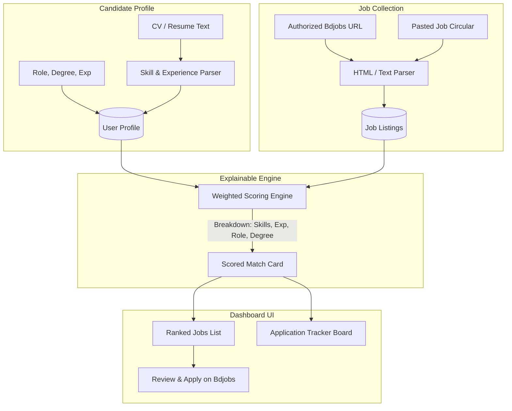

# 🎯 AI Job Matching & Application Tracker (Bdjobs Focus)

> An explainable AI matching engine and application lifecycle tracker designed for Bangladesh's tech and Software QA / CSE job market.

[](https://github.com/example/job-matcher/actions)


---

## 📌 Problem & Concept

Job portals like **Bdjobs.com** list hundreds of IT and Software Engineering circulars. However, candidates face two key friction points:
1. **Opaque or Misleading Match Scores**: Most platforms say "85% match" without explaining *why* or what technical skills the candidate is actually missing.
2. **Scraping / Compliance Issues**: Automated scrapers frequently break, violate Terms of Service, or get blocked by Cloudflare/session walls.

### The Solution:
- **Explainable Match Scoring**: Instead of a black-box number, every circular provides an explicit, transparent breakdown:
  ```
  Software QA Engineer
  Illustrative match score: 82/100

  Matched: Java, SQL, Git, API testing
  Missing: Selenium, 1 year of experience
  ```
- **Ethical Human-in-the-Loop Workflow**: Users import job circulars via authorized URLs or direct text pasting. The system provides a direct link to the official Bdjobs page for candidates to review and submit applications themselves.
- **Application Tracker (Kanban Board)**: Track candidate status from **Wishlist $\rightarrow$ Applied $\rightarrow$ Screened $\rightarrow$ Interviewing $\rightarrow$ Offered**.
- **Portfolio SQA Suite**: Built with automated testing (`pytest` for API/scoring logic, `Playwright` for E2E user flows).

---

## 🏗️ System Architecture



---

## 📊 Explainable Matching Algorithm

The engine computes an explainable score $S \in [0, 100]$ using four weighted criteria:

| Component | Weight | Logic & Evaluation |
| :--- | :---: | :--- |
| **Technical Skills** | **50%** | $\frac{|\text{User Skills} \cap \text{Job Skills}|}{|\text{Job Skills}|} \times 50$ (Categorized into Matched vs. Missing) |
| **Experience** | **25%** | Candidate exp vs. Minimum required exp. Meets requirement = 25 pts; partial credit with explicit gap notification (e.g. *"-1 year short"*). |
| **Role Alignment** | **15%** | Keyword alignment between candidate target title (e.g. *Software QA Engineer*) and job title. |
| **Academic Degree** | **10%** | Degree verification (e.g. *B.Sc. in CSE / IT*). |

---

## 🛠️ Tech Stack

- **Backend**: Python 3.11+, FastAPI, SQLAlchemy, Pydantic, BeautifulSoup4, HTTPX
- **Frontend**: React 18, TypeScript, Vite, Tailwind CSS, Lucide Icons
- **Database**: SQLite (default, zero-setup) / PostgreSQL supported via `DATABASE_URL`
- **Testing (SQA Portfolio)**: Pytest (Unit & API tests), Playwright (End-to-End browser tests)
- **Deployment**: Docker, Docker Compose, GitHub Actions CI

---

## 🚀 Quick Start (Local Setup)

### 1. Start Backend API
```powershell
cd e:\Job\backend
# Create and activate virtual environment (already initialized)
venv\Scripts\activate

# Run FastAPI server with auto-reload
uvicorn app.main:app --reload --port 8000
```
Backend will be live at: **`http://localhost:8000`**  
Interactive Swagger API Docs: **`http://localhost:8000/docs`**

### 2. Start Frontend UI
```powershell
cd e:\Job\frontend
# Install dependencies (already installed)
npm install

# Run Vite dev server
npm run dev
```
Frontend will be live at: **`http://localhost:3000`**

---

## 🧪 SQA Testing & Test Automation

### Run Backend Unit & API Tests (`pytest`)
```powershell
cd e:\Job
backend\venv\Scripts\pytest backend/tests -v
```
**Test coverage includes:**
- `test_matcher.py`: Canonical skill extraction, experience gap detection, and the illustrative 82/100 score test.
- `test_api.py`: Profile updates, job seeding, scoring endpoints, and the full application lifecycle.

### Run Playwright E2E Tests
```powershell
cd e:\Job\frontend
npx playwright test
```

---

## 🐳 Docker Deployment

To launch both backend and frontend in isolated containers:
```bash
docker-compose up --build
```
Access the application at `http://localhost:3000`.

---

## 📋 Staged Project Roadmap

- [x] **Stage 1 (MVP)**:
  - User CV / preferences setup
  - Paste job descriptions or import via URL
  - Explainable match scoring engine with matched/missing skill pills
  - Personal application tracking Kanban board
  - Automated test suite (Pytest + Playwright)
- [ ] **Stage 2**:
  - Authorized RSS / API feed ingestion
  - Salary expectation filter (BDT)
- [ ] **Stage 3**:
  - Email / Telegram notifications for 85%+ matched jobs
  - Duplicate listing detection and deadline expiry reminders
- [ ] **Stage 4**:
  - Multi-platform aggregation (Bdjobs + LinkedIn + company portals)
  - Interview preparation AI suggestions based on missing skill gaps
