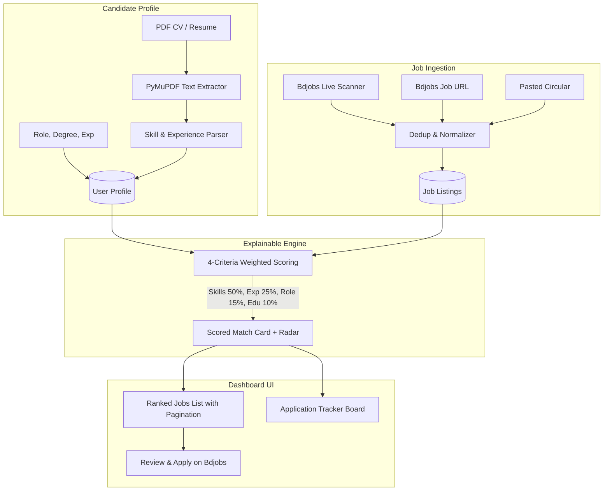

# 🎯 AI Job Matching & Application Tracker (Bdjobs Focus)

> An explainable AI matching engine and application lifecycle tracker designed for Bangladesh's tech and Software QA / CSE job market. Built with FastAPI, React, TypeScript, PyMuPDF, and automated testing.

[](https://github.com/marufahmedanik/AI-Job-Matching-Application-Tracker/actions)


---

## 👨‍💻 Candidate Profile

- **Developer**: **Md. Maruf Ahmed Anik**
- **Education**: B.Sc. in Computer Science and Engineering, East West University
- **Profiles**: [LinkedIn](https://linkedin.com/in/marufahmedanik) &bull; [GitHub](https://github.com/marufahmedanik)

---

## 📌 Problem & Concept

Job portals like **Bdjobs.com** list hundreds of IT and Software Engineering circulars. However, candidates face key friction points:
1. **Opaque Match Scores**: Most platforms state an unexplained percentage (e.g., "85% match") without detailing *which* skills matched or what gaps remain.
2. **Aggressive Web Scraping Risks**: Brittle HTML scraping violates Terms of Service and breaks on UI changes.

### The Solution:
- **Explainable Match Scoring**: Every circular shows a clear 4-criteria breakdown (Skills 50%, Experience 25%, Target Role 15%, Degree 10%):
  ```
  Software QA Engineer
  Illustrative match score: 82/100

  Matched: Java, SQL, Git, API testing
  Missing: Selenium, 1 year of experience
  ```
- **Live Bdjobs Scanner (`/h/jobs`)**: Connects directly to Bdjobs live search feeds for IT & Telecommunication (Category 8) and SQA circulars, automatically ingesting listings and ranking them against your CV.
- **Ethical Human-in-the-Loop Workflow**: Never automates candidate login or submits credentials; direct "Apply on Bdjobs ↗" links open the verified listing for human review.
- **Application Tracker (Kanban Board)**: Track candidate progress across **Saved $\rightarrow$ Applied $\rightarrow$ Screened $\rightarrow$ Interviewing $\rightarrow$ Offered $\rightarrow$ Rejected**.
- **PyMuPDF Resume Parsing**: Upload a PDF CV or paste text to auto-extract technical skills and calculate domain competency radar charts.
- **Deadline Monitoring**: Automatic categorization of deadlines into `EXPIRING_SOON` (within 7 days), `ACTIVE`, `OPEN`, and `EXPIRED`.

---

## 🏗️ System Architecture



---

## 🛠️ Tech Stack

- **Frontend**: React 18, TypeScript, Tailwind CSS, Lucide Icons, Recharts (Skill Radar Charts).
- **Backend**: Python 3.11+, FastAPI, SQLAlchemy, SQLite (local) / PostgreSQL (production).
- **Matching Engine**: Canonical technical skills taxonomy (50+ tech skills), regex boundary parsing, explainable weighted scoring.
- **PDF & Web Processing**: PyMuPDF (`pymupdf`), BeautifulSoup4, HTTPX.
- **Testing & Quality Assurance**: Pytest, `pytest-cov` (83% test coverage), Playwright E2E.
- **Deployment**: Docker, Docker Compose, GitHub Actions CI.

---

## 🚀 Quick Start (Local Development)

### 1. Prerequisites
- Python 3.11+
- Node.js 18+
- Git

### 2. Backend Setup
```bash
cd backend
python -m venv venv

# Windows
.\venv\Scripts\activate
# Linux/macOS
source venv/bin/activate

pip install -r requirements.txt
uvicorn app.main:app --host 127.0.0.1 --port 8000 --reload
```
API Documentation will be live at: [http://127.0.0.1:8000/docs](http://127.0.0.1:8000/docs)

### 3. Frontend Setup
```bash
cd frontend
npm install
npm run dev
```
Dashboard will be live at: [http://localhost:3000](http://localhost:3000)

---

## 🐳 Docker Deployment

Run the complete stack with PostgreSQL using Docker Compose:

```bash
docker compose up --build
```
- Frontend: `http://localhost:3000`
- Backend API: `http://localhost:8000`
- PostgreSQL: Port `5432`

---

## 🧪 Automated Testing & Coverage

Run unit and integration tests with coverage report:

```bash
cd backend
pytest --cov=app tests/ --cov-report=term-missing
```

**Results:**
- **16 passed tests**
- **83% Code Coverage** across all core modules (`matcher.py`, `models.py`, `schemas.py`, `bdjobs_scanner.py`, `parser.py`).

---

## 📄 License
MIT License. Built for educational and career portfolio purposes.
